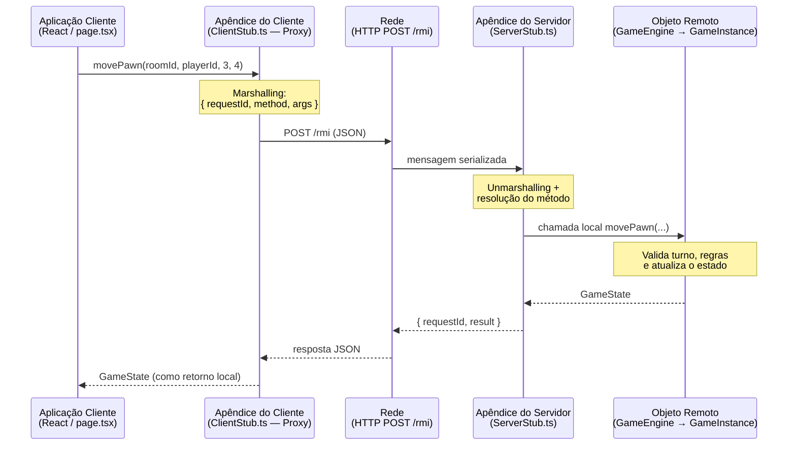
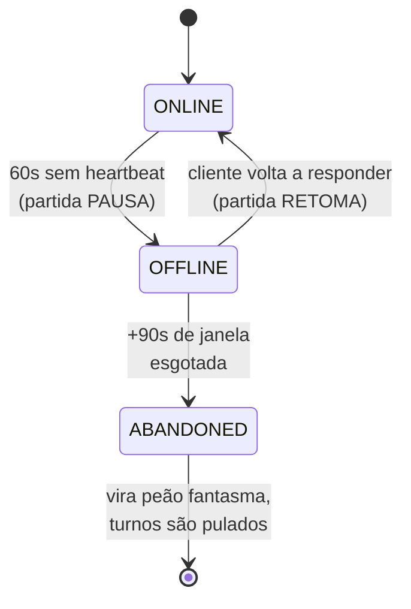

# 🕹️ Quoridor Distribuído — RMI sobre HTTP Request/Reply

> Trabalho da 1ª unidade de **Sistemas Distribuídos** — Universidade Estadual de Santa Cruz (UESC)
> Prof. Dr. Paulo André S. Giacomin · DEC — Área de Computação
> Autora: **Cibelle**

Implementação distribuída do jogo de tabuleiro **Quoridor** para 4 jogadores, onde cada jogador
roda em um **processo cliente independente** e toda a comunicação acontece por **Invocação de
Métodos Remotos (RMI/RPC)** sobre o paradigma **Solicitação/Resposta HTTP** — sem nenhum uso de
Sockets, WebSockets ou conexões TCP persistentes.

> 📦 **Este repositório contém o PROCESSO SERVIDOR.** O processo cliente fica em
> [`quoridor-rmi-web`](https://github.com/) — você precisa dos dois para jogar.

---

## 📋 Conformidade com a especificação

| Requisito do enunciado | Como foi atendido |
|---|---|
| Versão **distribuída** do Quoridor | Estado da partida vive exclusivamente no processo servidor; clientes não têm cópia autoritativa |
| Cada jogador usa um **processo cliente separado** | Cada jogador abre sua própria janela/aba do navegador, que é um processo renderizador isolado com seu próprio Client Stub e seu próprio `playerId` |
| **4 jogadores** | Tabuleiro 9x9 com os 4 peões cardeais (N, S, W, E); a partida só inicia quando os 4 processos se registram |
| Deve usar **RMI ou RPC** | Stub do cliente (via `Proxy`) + Apêndice do servidor (skeleton) + interface remota (`IGameRemote`) como IDL. Ver [Arquitetura](#-arquitetura-rmi) |
| **Não usar Socket** | Transporte 100% HTTP `POST /rmi` request/reply. Nenhum socket, WebSocket ou stream persistente no código |
| Interface **gráfica ou textual** | Interface gráfica web com tema arcade, construída em CSS puro |
| Necessário um **processo servidor** | `quoridor-rmi-server` — processo Node.js autônomo que hospeda o objeto remoto |
| Pode rodar **na mesma máquina** | É o modo padrão: 1 processo servidor + 4 janelas cliente em `localhost` |

---

## 🚀 Como executar

### Pré-requisitos

- **Node.js 20.9 ou superior** (`node --version` para conferir) — [nodejs.org](https://nodejs.org)
- npm (já vem junto com o Node)
- Conexão com a internet **apenas na primeira execução**, para baixar as dependências

### Passo 1 — Instalar as dependências

Abra um terminal **em cada uma das duas pastas** e rode:

```bash
# Na pasta do servidor
cd quoridor-rmi-server
npm install

# Na pasta do cliente
cd quoridor-rmi-web
npm install
```

### Passo 2 — Subir o processo servidor

No terminal da pasta `quoridor-rmi-server`:

```bash
npm run dev
```

Você verá a confirmação de que o objeto remoto foi registrado:

```
==============================================================
🚀 Servidor RMI Quoridor (Lobby e Múltiplas Salas) na porta 4000
🔗 Endpoint de Invocação Remota: http://localhost:4000/rmi
📦 Objeto Remoto Registrado: LobbyManager -> IGameRemote
==============================================================
```

> 💡 Para conferir que o servidor está no ar, abra <http://localhost:4000> no navegador — ele
> responde um JSON de *health check* descrevendo o serviço.

### Passo 3 — Subir os processos cliente

Em **outro terminal**, na pasta `quoridor-rmi-web`:

```bash
npm run dev
```

Depois abra <http://localhost:3000>.

> ⚠️ **Deixe os dois terminais abertos.** O servidor (porta 4000) e o cliente (porta 3000) são
> processos distintos e precisam estar rodando simultaneamente.

### Passo 4 — Jogar com 4 jogadores

1. Na tela inicial, digite um nome de sala e clique em **CRIAR SALA**.
2. Você será levado à sala. Digite seu nome e clique em **Entrar**.
3. Clique em **🔗 Copiar Link da Sala**.
4. Abra **mais 3 janelas do navegador** e cole o link em cada uma — cada janela é um processo
   cliente independente. Em cada uma, digite um nome diferente e entre.
5. Assim que o 4º jogador entrar, a partida inicia automaticamente.

> 🧪 **Testando sozinho na mesma máquina:** funciona normalmente — basta abrir 4 janelas (ou abas)
> com o mesmo link. Recomenda-se usar **janelas separadas lado a lado** em vez de abas, para
> conseguir acompanhar os 4 tabuleiros ao mesmo tempo durante a demonstração.

### Como se joga Quoridor

No seu turno você escolhe **uma** das duas ações:

- **🏃 Mover peão** — anda 1 casa na horizontal ou vertical. Se houver um peão adversário
  adjacente, você pode saltá-lo.
- **🧱 Posicionar barreira** — cada jogador tem 5 barreiras para atrapalhar os adversários.
  Uma barreira nunca pode fechar completamente o caminho de ninguém até seu objetivo.

**Vence quem primeiro alcançar a borda oposta à sua:** N precisa chegar à linha 9, S à linha 1,
W à coluna 9 e E à coluna 1.

---

## 🏗️ Arquitetura RMI

O sistema reproduz fielmente o modelo de RPC/RMI de Tanenbaum & van Steen: o cliente invoca um
método como se fosse local, o **Apêndice do Cliente (Client Stub)** empacota os parâmetros
(*marshalling*), a mensagem atravessa a rede, o **Apêndice do Servidor (Server Stub / Skeleton)**
desempacota e executa a chamada local no **Objeto Remoto**, e o retorno faz o caminho inverso.



### Componentes

| Camada | Arquivo | Papel |
|---|---|---|
| **Interface Remota (IDL)** | `src/IGameRemote.ts` | Contrato que define os métodos remotos e os tipos trafegados. Replicado no cliente. |
| **Objeto Remoto** | `src/GameEngine.ts` | `GameInstance` = uma partida isolada. `GameEngine` = *Registry* que roteia chamadas por `roomId`. |
| **Apêndice do Servidor** | `src/ServerStub.ts` | Desserializa a mensagem, resolve o método por reflexão, invoca localmente e empacota o retorno (inclusive exceções remotas). |
| **Transporte** | `src/index.ts` | Servidor HTTP que expõe o endpoint único `POST /rmi`. |
| **Apêndice do Cliente** | `src/app/rmi/ClientStub.ts` | Gerado dinamicamente com `Proxy` — intercepta qualquer método da interface e o transforma numa requisição remota. |

> 💡 **Por que um `Proxy` no Client Stub?** Em RMI tradicional o stub é gerado por um compilador
> de IDL. Aqui a metaprogramação do JavaScript cumpre esse papel em tempo de execução: qualquer
> método adicionado à interface passa a funcionar remotamente sem uma linha de código novo no stub.

### Interface remota exposta

| Método | Descrição |
|---|---|
| `createRoom(roomName)` | Instancia dinamicamente uma nova partida e devolve seu UUID |
| `listRooms()` | Serviço de diretório: lista as salas existentes e sua lotação |
| `joinGame(roomId, playerName)` | Registra um processo cliente numa sala e devolve sua identidade |
| `rejoinGame(roomId, playerId)` | Reassocia um cliente à sua sessão após recarga da página |
| `movePawn(roomId, playerId, row, col)` | Move o peão, sujeito à validação de turno e de regras |
| `placeWall(roomId, playerId, row, col, orientation)` | Posiciona uma barreira, sujeita à validação de caminho |
| `getGameState(roomId, playerId?)` | Sincroniza o estado **e** serve de *heartbeat* do cliente |
| `resetGame(roomId)` | Reinicializa a máquina de estados da partida |

---

## 🧠 Decisões de projeto

### Por que HTTP Request/Reply e não Socket?

O enunciado proíbe Sockets, e essa restrição é justamente o que torna o trabalho interessante:
RPC é um paradigma **síncrono e sem estado de conexão**. Cada invocação é autocontida — carrega
`roomId` e `playerId` — e o servidor não mantém nenhum canal aberto com os clientes. A
consequência direta disso aparece no tópico seguinte.

### Sincronização: *polling* em vez de *push*

Como o servidor não tem como iniciar uma comunicação (não há canal aberto), os clientes
descobrem mudanças **perguntando**: cada processo cliente invoca `getGameState` periodicamente.
É o custo inerente ao paradigma request/reply, e foi transformado em vantagem — ver abaixo.

### Detecção de falhas: *heartbeat* embutido no polling

Sem eventos de socket, o servidor não é notificado quando um cliente cai. A solução foi usar o
próprio polling como **sinal de vida**: `getGameState(roomId, playerId)` carrega a identidade de
quem perguntou, e o servidor registra aquele instante como `lastSeen` do jogador. A ausência de
requisições passa a ser a evidência da falha. Zero tráfego adicional — o heartbeat "pega carona"
numa chamada que já precisava acontecer.

### Isolamento de estado entre partidas

O objeto remoto principal é um **Registry** (`GameEngine`), não uma partida. Ele mantém um
`Map<roomId, GameInstance>` e roteia cada invocação para a instância correta. Assim o servidor
hospeda N partidas simultâneas sem nenhum compartilhamento de tabuleiro, turno ou barreiras —
e cada `GameInstance` preserva a lógica de jogo sem precisar conhecer o conceito de sala.

---

## 🛡️ Tolerância a falhas

Partidas de 4 jogadores são frágeis: basta um cair para travar o jogo de todos. O sistema trata
isso com uma máquina de estados de 3 níveis por jogador.



- **Micro-queda (até 60s)** — oscilação de rede ou recarga de página. Transparente: o cliente
  invoca `rejoinGame` e retoma de onde parou.
- **Pausa estratégica (90s)** — ao detectar uma queda real, a partida inteira entra em
  `PAUSED_DISCONNECT` em vez de eliminar o jogador na hora. Os demais aguardam a reconexão.
- **Abandono** — esgotada a janela, o jogador vira **peão fantasma**: permanece no tabuleiro como
  obstáculo físico, mas seus turnos são pulados e a partida segue com os restantes.
- **Vitória por W.O.** — se sobrar apenas 1 jogador ativo, ele é declarado vencedor.

> 🔍 Os tempos ficam no topo de `src/GameEngine.ts` (`MICRO_DROP_TIMEOUT_MS` e
> `ABANDON_WINDOW_MS`) caso queira acelerar a demonstração desse comportamento.

---

## ⚖️ Regras do Quoridor implementadas

- Tabuleiro 9x9, 4 peões, **5 barreiras por jogador**
- Movimento ortogonal de 1 casa, com **salto** sobre peão adjacente
- Barreiras bloqueiam a passagem entre casas e **não podem se sobrepor nem se cruzar**
- **Validação por BFS** — a regra mais importante do Quoridor: antes de aceitar uma barreira, o
  servidor roda uma busca em largura para **cada** jogador e rejeita a jogada se ela deixar
  qualquer um sem nenhum caminho até seu objetivo. É o que impede o jogo de ser vencido
  simplesmente murando os adversários.
- **Exclusão mútua de turno** — toda ação é validada contra o jogador detentor do turno no
  servidor, de modo que um cliente adulterado não consegue jogar fora da vez

---

## 📡 Inspetor de Invocação Remota

A interface traz um painel lateral que registra **em tempo real cada invocação remota** —
método, argumentos empacotados, retorno e latência em milissegundos.

Ele existe para tornar o RMI visível: dá para acompanhar o `marshalling` saindo do Client Stub,
a resposta voltando do Server Stub e as exceções remotas sendo propagadas. É a forma mais direta
de demonstrar que a comunicação é realmente request/reply.

---

## 📂 Estrutura do projeto

```
quoridor-rmi-server/            # PROCESSO SERVIDOR
├── src/
│   ├── IGameRemote.ts          # Interface remota (IDL) + tipos compartilhados
│   ├── GameEngine.ts           # Objeto remoto: Registry de salas + motor do jogo
│   ├── ServerStub.ts           # Apêndice do servidor (skeleton)
│   └── index.ts                # Transporte HTTP — endpoint POST /rmi
└── package.json

quoridor-rmi-web/               # PROCESSO CLIENTE
├── src/app/
│   ├── page.tsx                # Lobby: criar e listar salas
│   ├── partida/[roomId]/
│   │   └── page.tsx            # Tabuleiro, ações e Inspetor RMI
│   ├── rmi/
│   │   ├── ClientStub.ts       # Apêndice do cliente (Proxy)
│   │   └── IGameRemote.ts      # Cópia do contrato remoto
│   └── globals.css             # Tema arcade — CSS puro, sem frameworks
└── package.json
```

---

## 🔧 Configuração

Por padrão o cliente procura o servidor em `http://localhost:4000`. Para apontar para outra
máquina (jogar em rede local, por exemplo), crie um arquivo `.env.local` na pasta
`quoridor-rmi-web`:

```env
NEXT_PUBLIC_RMI_SERVER_URL=http://192.168.0.108:4000
```

O servidor já envia os cabeçalhos CORS necessários para aceitar invocações de outras origens.

---

## ⚠️ Limitações conhecidas

Documentadas por honestidade técnica — são consequências deliberadas do escopo do trabalho:

- **Estado em memória.** As salas vivem na memória do processo servidor; reiniciá-lo descarta as
  partidas em andamento. Persistência não fazia parte do escopo.
- **Contrato duplicado.** `IGameRemote.ts` existe nos dois projetos. Em um RMI real o stub seria
  gerado a partir de uma IDL compartilhada; aqui, sem um pacote comum entre os dois processos, a
  cópia é mantida manualmente em sincronia.
- **Custo do polling.** Request/reply implica consultas periódicas, o que gera mais tráfego que
  um modelo *push*. É o preço do paradigma exigido pelo enunciado — e o que viabilizou o
  heartbeat sem custo extra.
- **Sem autenticação.** Qualquer pessoa com o link entra na sala. Não há identidade persistente
  entre sessões além do `playerId` guardado localmente no navegador.

---

## 📚 Referências

- TANENBAUM, A. S.; VAN STEEN, M. *Sistemas Distribuídos: Princípios e Paradigmas*. 2ª ed.
  — modelo de RPC, apêndices (stubs), marshalling e transparência de acesso
- COULOURIS, G. et al. *Sistemas Distribuídos: Conceitos e Projeto*. 5ª ed.
  — detecção de falhas e modelos de falha por temporização
- [Regras oficiais do Quoridor](https://www.youtube.com/watch?v=39T3L6hNfmg)
